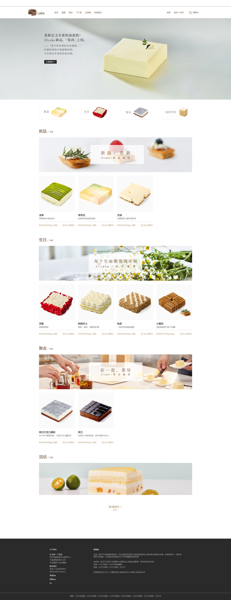

# 21cake 蛋糕电商静态页面复刻

🔗 在线预览：https://anxinyang2027.github.io/21cake-static-page/homepage.html

> 纯前端静态练习项目，不包含后端与数据交互

## ✨ 项目介绍

复刻21cake甜品电商PC端网站，还原品牌简约高级的视觉风格。一共包含首页、商品页、购物车、登录、注册、个人介绍等多个独立页面，实现锚点平滑滚动、卡片hover放大标签浮现等交互效果，仅前端静态页面，用于HTML+CSS学习练习。

## 🛠 技术栈

- HTML5
- CSS3（Flex / Grid布局、transition过渡动画）
- 原生 JavaScript
- iconfont 图标字体

## 📁 项目结构

HTML_final/
├── css/                      # 分页面独立样式文件
│   ├── cart.css
│   ├── homepage.css
│   ├── login.css
│   ├── login-new-user.css
│   ├── login-user.css
│   └── uu.css
├── fonts/                    # iconfont 图标字体
│   ├── demo_index.html
│   └── iconfont.ttf
├── images/                   # 全部页面图片素材
├── homepage.html             # 首页（入口）
├── mall.html                 # 商品列表页
├── cart.html                 # 购物车页面
├── login-user.html           # 用户登录页
├── login-new-user.html       # 新用户注册页
├── uu.html                   # 个人介绍页
├── README.md
├── .gitignore
└── LICENSE

## 🎯 功能实现

- 首页：导航栏、宣传Banner、分类入口、新品蛋糕商品展示区
- 锚点平滑滚动：点击新品/生日/聚会分类，平滑滚动至对应商品区域
- Hover交互：卡片悬浮放大、标签浮现动效
- 多页面联动：首页、商品、购物车、登录注册、个人页
- 图标体系：iconfont字体图标引入使用
- 分文件管理CSS：每个页面独立样式文件，便于维护

## 🚀 运行方式

直接打开根目录下 `homepage.html` 即可在浏览器预览，不需要配置服务器。

## 📌 版权声明

本项目仅用于前端学习练习，**非官方网站**。页面中品牌文案、蛋糕图片素材版权归属21cake，禁止商用。
